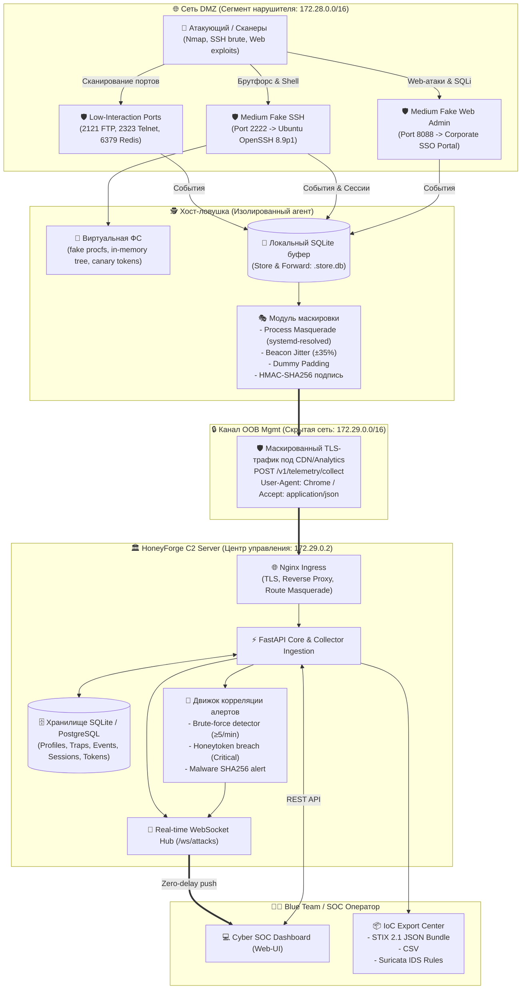

# Архитектура платформы HoneyForge

## 1. Концепция и назначение
HoneyForge — централизованная промышленная платформа класса Deception / Honeynet Management, предназначенная для Blue Team и SOC. Платформа позволяет конфигурировать, развертывать и вести непрерывный мониторинг распределенного парка ловушек (Low/Medium/High Interaction) со скрытым Out-of-Band (OOB) каналом связи и продвинутой маскировкой.

---

## 2. Диаграмма потоков данных и сетевого разделения

---

## 3. Ключевые компоненты

### 3.1 Центр управления (C2 Server)
1. **Control API (FastAPI)**:
   - CRUD профилей ловушек (FR-C1).
   - Регистрация и мониторинг ловушек (FR-C2).
   - Безопасная выдача конфигурации (FR-C3).
   - Хранение и фильтрация событий атак (FR-C4).
   - Аутентификация оператора на базе JWT и аудит действий (FR-C5).
   - 1-Click Orchestrator: генерация Docker Compose, Bash и PowerShell артефактов (FR-C6).
   - Движок автоматических алертов и IoC экспортер (FR-C7).
2. **WebSocket Hub**:
   - Асинхронный широковещательный хаб для мгновенной передачи событий на фронтенд без поллинга.
3. **Хранилище (SQLAlchemy ORM)**:
   - Единая схема данных для SQLite (Standalone) и PostgreSQL (Production).

### 3.2 Агент ловушки (HoneyForge Agent)
1. **Low-Interaction Engine**:
   - Мультипортовый асинхронный TCP/UDP сервер с правдоподобными баннерами (FTP, Telnet, Redis).
2. **Medium-Interaction SSH Daemon**:
   - Реализован на Paramiko. Полноценный протокол SSH, захват учетных записей, виртуальный bash-терминал с поддержкой команд (`whoami`, `cat /etc/passwd`, `wget`, `uname -a`), перехват загрузок вредоносного ПО с фиксацией SHA-256.
3. **Medium-Interaction Fake Web Admin**:
   - HTTP веб-сервер с формой аутентификации, сбор логинов/паролей, SQL-инъекций и path traversal запросов.
4. **Honeytokens Subsystem**:
   - Генерация canary токенов: AWS ключи, приватные ключи, фальшивые хэши `/etc/shadow` и Canary URLs с мгновенным критическим алертом при обращении.
5. **Local Event Buffer (Store & Forward)**:
   - Локальная база SQLite для надежного буферизирования событий при обрыве сети.
6. **Stealth & Obfuscation Engine**:
   - Подмена имени процесса в ОС (`systemd-resolved`, `rsyslogd`, `svchost.exe`).
   - Рандомизация интервалов опроса (джиттер ±35%).
   - Случайный dummy padding в сетевых пакетах.
   - Маскировка HTTP-заголовков под легитимный CDN/браузер.

---

## 4. Спецификация мер маскировки (MASK Requirements)

| Требование | Реализация в HoneyForge |
| :--- | :--- |
| **MASK-1 (Шифрование)** | TLS шифрование + HMAC-SHA256 подпись каждого пакета с защитой от replay-атак через уникальный nonce. |
| **MASK-2 (Неприметный Endpoint)** | Телеметрия отправляется на эндпоинты `/v1/telemetry/collect` и `/cdn-cgi/telemetry/pixel.gif`, имитируя сбор метрик производительности CDN. Заголовки маскируются под Google Chrome. Ответ сервера — валидный JSON метрик CDN или прозрачный 1x1 GIF. |
| **MASK-3 (Разделение интерфейсов)** | Архитектура Dual-homed: сеть `honeynet_dmz` доступна сканерам и атакующим, а сеть `honeyforge_mgmt` изолирована (`internal: true`) и используется агентом для OOB связи с C2. |
| **MASK-4 (Скрытность на хосте)** | Подмена имени процесса (`setproctitle`/`prctl`) на `systemd-resolved`/`rsyslogd`. Отсутствие маркеров «honeypot» в исполняемых файлах и логах на хосте ловушки. |
| **MASK-5 (Джиттер и Padding)** | Динамический расчет интервала beacon: \(T = T_{base} \times (1 \pm \text{jitter})\). Добавление случайного padding-хвоста (32–128 байт), препятствующего статистическому анализу размеров пакетов системами NTA/Zeek. |
| **MASK-6 (Анти-фингерпринтинг)** | Аутентичные баннеры `SSH-2.0-OpenSSH_8.9p1 Ubuntu-3ubuntu0.6`, `Apache/2.4.52`, реалистичная файловая структура Linux без следов Docker/QEMU в виртуальном шелле. |
| **MASK-7 (Взаимная аутентификация)** | HMAC-SHA256 проверка секретного ключа ловушки и временной метки (максимальный дрейф 600 сек). |
