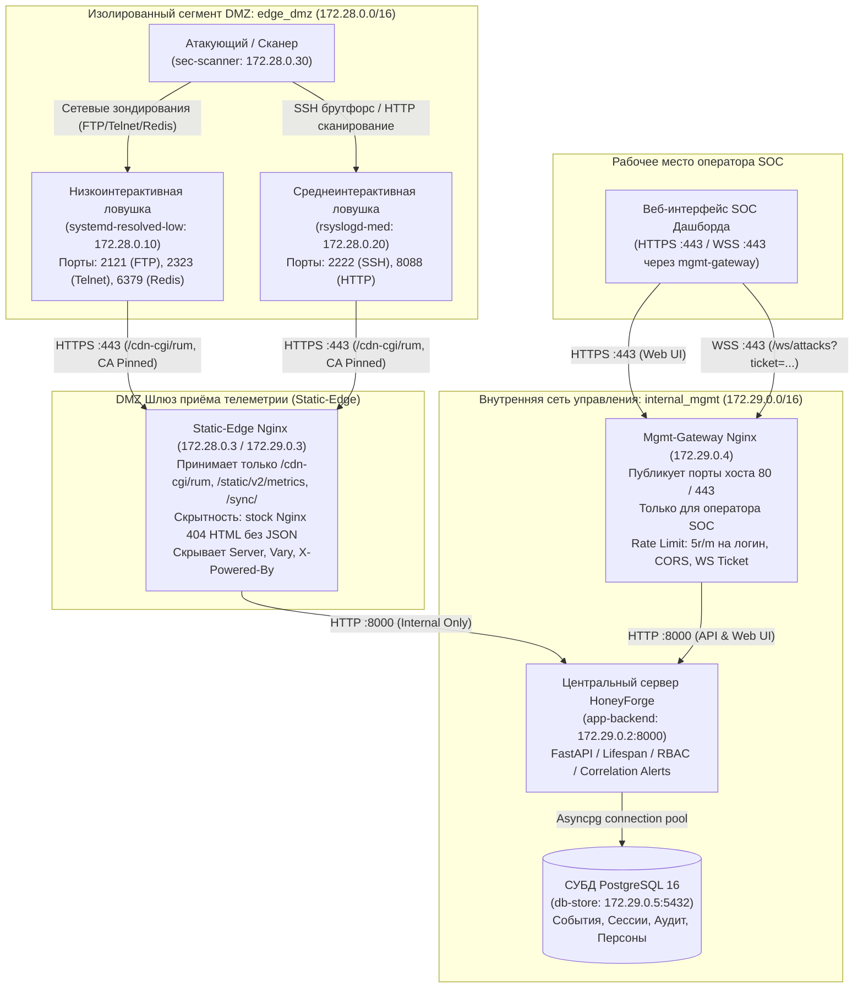
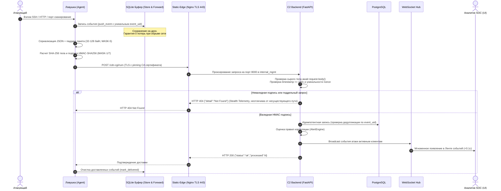

# Сетевая архитектура и потоки данных HoneyForge

## 1. Сегментация сети и изоляция (MASK-3)

Платформа HoneyForge реализует строгое разделение сетевых сегментов в Docker Compose:
- **Сегмент `edge_dmz` (`172.28.0.0/16`)**: изолированная демилитаризованная зона. Содержит контейнеры ловушек (`systemd-resolved-low`, `rsyslogd-med`), симулятор атак (`sec-scanner`) и внешний интерфейс шлюза обратного прокси (`static-edge`: `172.28.0.3`).
- **Сегмент `internal_mgmt` (`172.29.0.0/16`)**: изолированная out-of-band сеть управления. Содержит внутренний интерфейс шлюза (`static-edge`: `172.29.0.3`), сервер управления C2 (`app-backend`: `172.29.0.2`) и СУБД (`db-store`: `172.29.0.5`).

Ловушки в `edge_dmz` **физически не имеют маршрута** к серверу управления (порт 8000) или к базе данных (порт 5432). Единственная точка взаимодействия — защищенный HTTPS обратный прокси (`static-edge`, порт 443).

---

## 2. Сквозной поток телеметрии (Data Flow Pipeline)

---

## 3. Маскировка каналов связи и процессов (MASK-1...7)

1. **Криптографическая верификация**: Защита от подделки телеметрии через HMAC-SHA256 подпись: `f"{trap_id}:{ts}:{nonce}:{sha256(raw_body)}"`. Срок жизни nonce — 180 секунд.
2. **Stealth Telemetry**: Запросы без валидной HMAC-подписи возвращают стандартный FastAPI 404 Not Found (`{"detail":"Not Found"}` с заголовком `content-length: 22` и `content-type: application/json`), полностью неотличимый от обращения к случайному несуществующему эндпоинту.
3. **Сертификатный пиннинг**: Все агенты в контейнерах используют параметр `SSL_CERT_PATH=/etc/ssl/certs/static-edge.crt` для строгой валидации открытого ключа шлюза без доверия системному хранилищу ОС.
4. **Маскировка процессов**: Исполняемые процессы ловушек подменяют имя в выводе `ps` и `/proc` через `prctl(PR_SET_NAME)` и `setproctitle`:
   - Низкоинтерактивная ловушка: `systemd-resolved`
   - Среднеинтерактивная ловушка: `rsyslogd`
