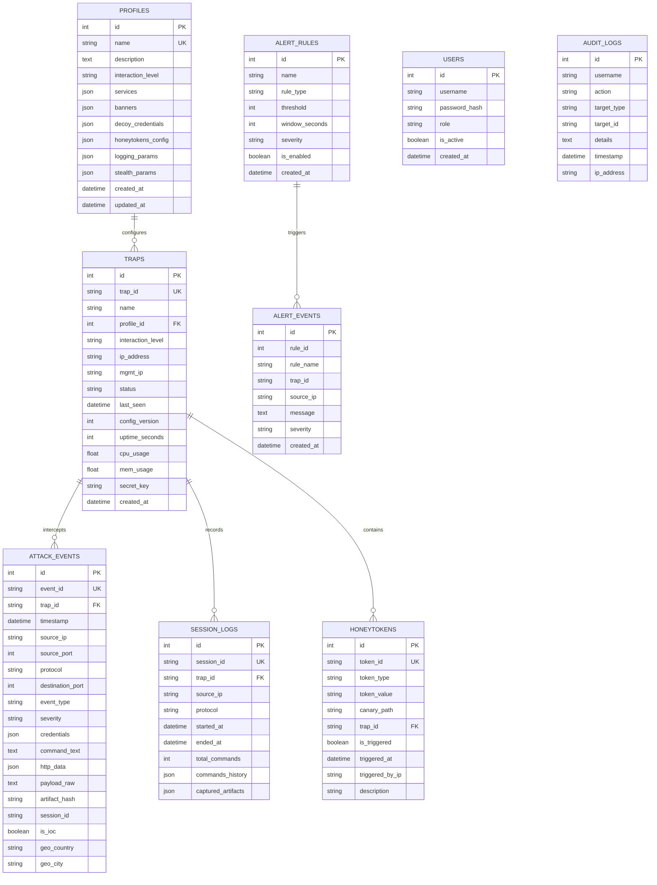

# Схема базы данных HoneyForge

База данных HoneyForge спроектирована на базе SQLAlchemy 2.0 ORM и совместима как с легковесной встраиваемой **SQLite** (через асинхронный драйвер `aiosqlite`), так и с высокопроизводительной **PostgreSQL** (через `asyncpg`).

---

## 1. ER-Диаграмма

---

## 2. Описание таблиц

### 2.1 `profiles` (Профили ловушек — FR-C1)
Хранит шаблоны конфигураций deception-окружения:
- `services`: список активируемых служб (e.g. `["ssh", "http", "redis", "ftp"]`).
- `banners`: словарь аутентичных сетевых баннеров `{21: "220 ProFTPD...", 22: "SSH-2.0-OpenSSH..."}`.
- `decoy_credentials`: список учетных записей-приманок для принятия или мониторинга.
- `stealth_params`: параметры скрытности (джиттер, размер padding, имя процесса маскировки).

### 2.2 `traps` (Парк ловушек — FR-C2)
Реестр развернутых ловушек:
- `trap_id`: уникальный идентификатор ловушки.
- `status`: текущее состояние (`online`, `offline`, `degraded`).
- `last_seen`: время последнего полученного beacon-сигнала.
- `secret_key`: HMAC-ключ для взаимной аутентификации.

### 2.3 `attack_events` (Телеметрия атак — FR-C4)
События входящей активности:
- `event_type`: тип активности (`port_scan`, `banner_probe`, `auth_attempt`, `shell_command`, `web_request`, `honeytoken_triggered`, `file_download`).
- `credentials`: захваченная пара логин/пароль.
- `command_text`: выполненная в шелле команда.
- `artifact_hash`: SHA-256 хэш загруженного вредоноса.
- `is_ioc`: флаг для включения в выгрузку Threat Intelligence (STIX 2.1).

### 2.4 `session_logs` (Интерактивные сессии — Asciinema Replay)
Полная хронология действий атакующего:
- `commands_history`: упорядоченный список введенных команд и ответов терминала с временными метками.
- `captured_artifacts`: метаданные перехваченных файлов.

### 2.5 `honeytokens` (Приманки Honeytokens — FR-A6)
- Отслеживание canary-артефактов (AWS ключи, вебхуки, хэши паролей). При фиксации чтения или перехода статус меняется на `is_triggered = True`.
