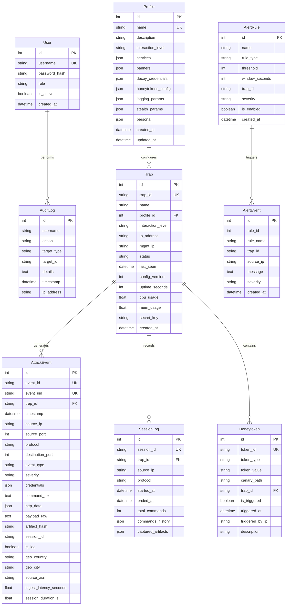

# Схема базы данных HoneyForge (PostgreSQL / SQLite)

Архитектура хранения данных построена на базе реляционной СУБД (PostgreSQL в docker-окружении, aiosqlite для автономного запуска). Все модели реализованы через SQLAlchemy 2.0 Asyncio.

## Особенности структуры
1. **Идемпотентность и дедупликация (FR-A4)**: Поле `event_uid` в таблице `attack_events` обеспечивает строгую дедупликацию телеметрии при повторной передаче из локального буфера SQLite.
2. **Хостовая персона (MASK-6)**: Поле `persona` в таблице `profiles` хранит параметры эмуляции реальной ОС (hostname, OS, kernel, uptime, users).
3. **Безопасность учетных записей (FR-C5)**: В таблице `users` пароли хранятся в формате `pbkdf2$<salt_hex>$<hash_hex>` (600,000 итераций).
